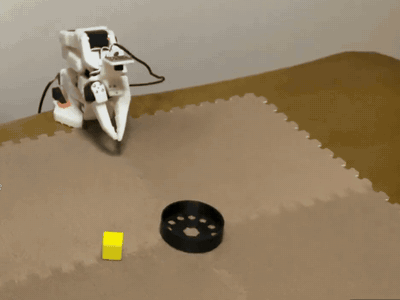
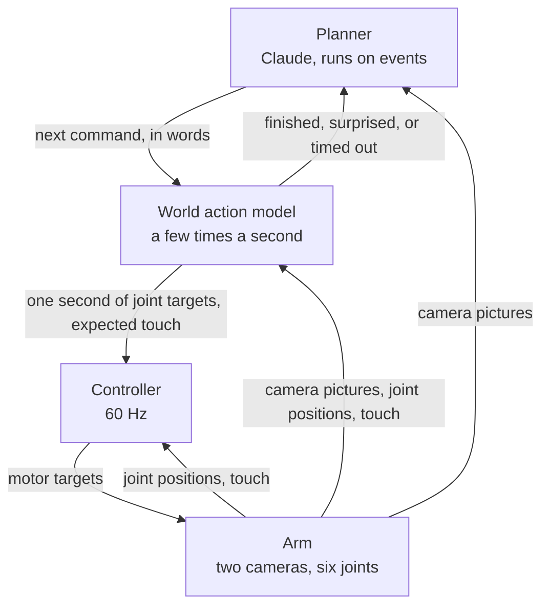

# A three-layer robot stack on a real arm

[](https://github.com/lukeahamond/robot-stack/actions/workflows/tests.yml)

A robot arm that is told what to do in words and then does it. Three models run at three
speeds: a planner that looks and decides, a world action model that turns a command into
movement, and a controller that drives the motors. The stack was built for one SO-ARM101
and runs on it.

[](results/so101/result.mp4)

A clip from the session at double speed. Click it for the
[full-quality video](results/so101/result.mp4), which is stored with Git LFS: a clone
without Git LFS installed gets a small pointer file in its place.

## Result

One real SO-ARM101, with Claude through the Anthropic API as the planner and 50
demonstrations per command. Each row is 20 trials, so each rate is rough; the last column
is the 95% range the true rate likely falls in. Details and how to run it are in
[SO101.md](SO101.md).

| Situation | Successes | Likely range |
|---|---|---|
| Block in the positions used in the demonstrations | 15 / 20 | 53–89% |
| Block in new positions inside the demonstrated area | 12 / 20 | 39–78% |
| Recovers after a missed grasp or a drop | 7 / 20 | 18–57% |
| Changed conditions: a moved lamp, a tablecloth or a darker block | 11 / 20 | 34–74% |

Every trial is listed in [results/so101/trials.csv](results/so101/trials.csv).

## How it works

| Layer | Runs | What it is | Job |
|---|---|---|---|
| Planner | When something happens: a command finishes, the hand loses what it held, or time runs out | Claude through the API. Not trained here. | Looks at the camera pictures and picks the next command, in words |
| World action model | A few times a second | A transformer on top of a pretrained image encoder (DINOv2), trained on the recorded demonstrations | From two cameras, joint positions, touch and the command, produces one second of joint targets, the touch it expects to feel, and whether the command is finished |
| Controller | 60 times a second | A fixed loop. The servos close their own position loop, so nothing is learned. | Smooths the targets, enforces speed and range limits, protects the gripper, measures touch |



What crosses each boundary:

- **Planner to world action model:** one short command in words, such as "pick up the red
  block", chosen from the commands the arm was trained on. Nothing else.
- **World action model to controller:** joint targets and the touch it expects.
- **Back up to the planner:** one of three events, plus the current camera pictures.

Three rules hold the layers together:

- **The surprise alarm.** The world action model predicts what the hand should feel. If
  the hand was holding something, the model expected to keep feeling it, and the gripper
  feels nothing, control goes back to the planner at once.
- **The lower layers are safe alone.** If the planner is slow, unreachable or gives an
  answer that cannot be used, the arm holds still.
- **Every layer is replaceable.** The planner only ever sends words, so another model can
  take its place. A keyboard planner and a fixed-list planner are included.

Touch has no dedicated sensor on this arm. It is read from the gripper motor: if the
gripper stays further open than every command it was recently given, something is in the
way. The same rule is applied to the recorded demonstrations and to the live arm.

The world action model can also predict what the cameras will show next, as image
features. That is off by default when the arm runs, and the model is trained to work
without it.

## Run it

Recording demonstrations, training and running on the arm are covered step by step in
[SO101.md](SO101.md). The tests need no arm, no network and no API key:

```bash
python3 -m pytest -q
```

```bash
ruff check .
```

Needs Python 3.10 or later, PyTorch, MuJoCo, NumPy and Pillow. The real-arm code in `so101/`
needs Python 3.12 or later and the extras listed in [SO101.md](SO101.md).

## Model weights

The trained world action model's home on Hugging Face is
[lukehamond/robot-stack](https://huggingface.co/lukehamond/robot-stack). The repository is
private for now, so the link only works for accounts with access. See
[Data and weights](SO101.md#data-and-weights).

## Limits

- **Recovery and changed conditions are the weak rows.** Recovery after a miss or a drop
  worked in 7 of 20 trials, and changed conditions (a moved lamp, a tablecloth or a darker block) in 11 of 20.
- **A block of another shade is not handled.** That row splits into 11 of 14 with the yellow block
  (8 of 11 with the lamp moved or a new tablecloth, 3 of 3 with no change noted) and 0 of 6
  with a darker block in place of the yellow one.
- **The planner can only choose commands the arm was trained on.**

More in [SO101.md](SO101.md#limits).

## In this repository

| Path | What it is |
|---|---|
| [SO101.md](SO101.md), `so101/` | The stack for a real SO-ARM101 and a 24 GB GPU, with the Claude API as planner. The automated tests use a simulated stand-in arm. |
| [ARMSTACK.md](robot_stack_earlier/ARMSTACK.md), `robot_stack_earlier/armstack/` | An earlier version on a simulated arm, with the lower two layers trained from scratch. The stand-in arm in `so101/sim.py` imports from it, so it is still in use. |
| [ROBOSTACK.md](robot_stack_earlier/ROBOSTACK.md), `robot_stack_earlier/robostack/` | An earlier five-part version with a critic and a rollout check. Those two parts were left out of the later design. |
| `tests/` | Tests for all three, on simulated arms. |
| [Hugging Face](https://huggingface.co/lukehamond/robot-stack) | The trained model. Private for now. |
| [LICENSE](LICENSE) | MIT. |
