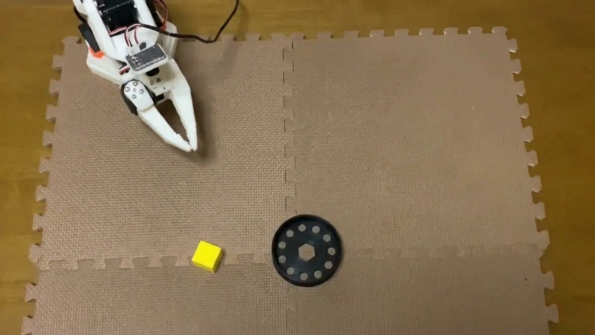
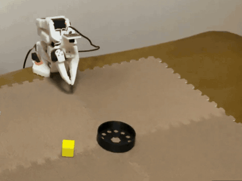

# so101: the three layers on a real SO-ARM101

The three-layer stack from [README.md](README.md), built for one SO-101 arm and a single NVIDIA GPU
with 24 GB of memory.

The result on the real arm is in [Result](#result). The code is written against LeRobot 0.7.
Read "Before the first real run" before powering anything.

| Layer | What it is here | Trained on |
|---|---|---|
| Planner | Claude through the API. It sees the camera pictures and picks the next command from the ones the arm was trained on. | Nothing here |
| World action model | A transformer on top of a pretrained image encoder (DINOv2). From two cameras, joint positions, touch and the command it produces one second of joint targets, the touch it expects, a "finished" flag, and a prediction of what the cameras will show. | Your recorded demonstrations |
| Controller | A 60 Hz loop that smooths the targets, enforces speed and range limits, protects the gripper and measures touch. The servos close their own position loop, so nothing is learned here. | Nothing |

Three things about it follow from the hardware:

- **Touch comes from the gripper motor.** The SO-101 has no touch sensor. If the gripper
  stays further open than every command it was recently given, something is in the way.
  That reading is the touch signal, in recordings and live.
- **The predicted future is image features, not video.** Generating pictures needs a
  pretrained video model that does not fit this budget. The middle layer sits behind one
  interface so a released pretrained model can replace it.
- **The controller is not learned.** A six-joint arm with position servos does not need
  the balance controller a humanoid does.

## Parts

| Part | What was used | Notes |
|---|---|---|
| Follower arm | SO-ARM101, bought as a kit | Feetech STS3215 servos, 1/345 gear ratio on every joint |
| Leader arm | SO-ARM101 leader | Only needed for recording |
| Power supply | 12 V, 5 A | |
| Front camera | Logitech C920 | USB, 640×480 at 30 fps |
| Wrist camera | 32 × 32 mm USB camera module | Mount: the 3D-printed wrist mount from the SO-ARM100 repository |
| GPU machine | NVIDIA RTX 4090 (24 GB), Ubuntu 24.04 | Training and running |
| Blocks and tray | See [The workspace](#the-workspace) | |

## Set up

Needs Python 3.12 or later.

```bash
uv venv --python 3.12 .venv
```

```bash
uv pip install --python .venv/bin/python "lerobot[feetech,dataset]>=0.7,<0.8" transformers mujoco "anthropic>=0.86" pytest
```

```bash
.venv/bin/python -m pytest -q tests/test_so101.py
```

On the machine with the NVIDIA GPU, install the PyTorch build for your CUDA version first.

## The workspace

The result below was recorded in this setup. Copying it is the closest way to repeat the
result.



The front camera and its stand are out of the frame.

- **Table:** 120 cm × 60 cm wooden table. The arm and the work area sit on brown foam
  puzzle mats laid over it.
- **Front camera:** Logitech C920, on a clamp stand 50 cm above the table and 40 cm in
  front of the arm's base, looking down at about 45°. 640×480 at 30 fps.
- **Wrist camera:** 32 × 32 mm USB module, fixed to the gripper with the 3D-printed wrist mount, looking along the jaws.
  640×480 at 30 fps.
- **Blocks:** 2.5 cm yellow wooden cubes, about 10 g each.
- **Tray:** round and black, with holes around its side, 15 cm across and 3 cm deep,
  25 cm from the arm's base.
- **Lighting:** overhead room lights, no daylight.
- **Demonstrated area:** blocks were placed inside a 20 × 20 cm patch. "New positions"
  in the result table means new spots inside that patch.

The commands in the examples below ("pick up the red block", "put it in the box") are
examples only. The real session used yellow blocks and a round tray, with the commands
"pick up the yellow block" and "put it in the tray".

## Record demonstrations

Each recorded episode is **one command**, and its task text is the command. A task such
as "put the red block in the box" is recorded as two sets of episodes: "pick up the red
block" and "put it in the box". The planner chains them.

Find the ports and cameras, calibrate both arms, then record. These are LeRobot's own
commands; replace the ports and camera indexes.

```bash
lerobot-find-port
```

```bash
lerobot-find-cameras opencv
```

```bash
lerobot-calibrate --robot.type=so101_follower --robot.port=/dev/ttyACM0 --robot.id=follower
```

```bash
lerobot-calibrate --teleop.type=so101_leader --teleop.port=/dev/ttyACM1 --teleop.id=leader
```

```bash
lerobot-record \
  --robot.type=so101_follower --robot.port=/dev/ttyACM0 --robot.id=follower \
  --robot.cameras="{front: {type: opencv, index_or_path: 0, width: 640, height: 480, fps: 30}, wrist: {type: opencv, index_or_path: 2, width: 640, height: 480, fps: 30}}" \
  --teleop.type=so101_leader --teleop.port=/dev/ttyACM1 --teleop.id=leader \
  --dataset.repo_id=local/pick_red --dataset.root=data/pick_red --dataset.no_stamp=true \
  --dataset.single_task="pick up the red block" \
  --dataset.fps=30 --dataset.episode_time_s=20 --dataset.reset_time_s=8 --dataset.num_episodes=50 \
  --dataset.push_to_hub=false --display_data=false
```

Repeat with a new `--dataset.root` and `--dataset.single_task` for each command. `prepare`
below takes several datasets at once.

What makes the recordings usable, learned the hard way in simulation:

- **End every episode the same way and then hold still** for about half a second. The
  last frames teach the "finished" flag. For a pick, end lifted. For a place, end with the
  gripper open and raised.
- **Close the leader's gripper fully when grasping.** The gap between "commanded shut" and
  "stopped on the object" is the touch signal.
- **Start a third of the episodes from awkward places:** beside the object, too low,
  gripper already closed on nothing, or holding the wrong object. Without these the arm
  cannot recover from its own mistakes.
- **Throw away failed episodes** (left arrow key during recording).
- **Make the objects easy to tell apart and large in the picture.** A wrist camera matters
  more than resolution.
- **Around 50 episodes per command** is the usual starting point for this arm. The
  simulated test used about 100 to 300 per command.

## Train

```bash
.venv/bin/python -m so101.cli prepare --dataset data/pick_red data/put_in_box --out data/store
```

```bash
.venv/bin/python -m so101.cli train --data data/store --out runs/so101/model.pt
```

```bash
.venv/bin/python -m so101.cli bench --model runs/so101/model.pt
```

`prepare` resizes every frame once (about 150 KB per frame per camera on disk). `train`
prints a held-out check every quarter of the way: how far the generated joint targets are
from the recorded ones on episodes it did not train on. `bench` times one call to the
model. On the RTX 4090, training took 1 h 52 min for 20,000 steps, and one model call takes
85 ms with future prediction off and 118 ms with it on, for 1.0 s of movement per call.

Every setting is in [so101/config.py](so101/config.py). The settings a trained model depends
on (picture size, model size, chunk length and the touch reading: the `TRAINED` list in
that file) are saved with the model and read back from it. Changing one of those means
training again. Every other setting, including the controller's limits, the events and the
planner, is read from `config.py` each time the arm runs.

## Before the first real run

1. **Clear the workspace and keep a hand on the power switch.** The speed limit is
   150 units a second per joint and can be lowered with `--max-speed`. The run prints the
   limit it is using.
2. **Dry run.** `--dry-run` reads the arm and cameras and runs every layer but sends
   nothing to the motors. Check that it starts, that the commands listed are yours, and
   that nothing crashes.
3. **Run with you as the planner** (`--planner manual`), one command at a time.
4. **Then the API planner.**

Things most likely to be wrong on a new arm or a new recording: camera names and indexes
not matching the recording, the camera picture size not matching the recording (`run` opens
the cameras at 640×480 unless given `--camera-width` and `--camera-height`), `use_degrees` not matching the recording (pass `--no-degrees`
if it was recorded with it off), the touch thresholds (`grip_squeeze` applies at once but must stay above `touch_full`, or a
held block never reads as touch; `touch_full` needs training again), and the 60 Hz loop being too fast for the serial bus.
The run prints a warning when the loop falls behind, because movement then plays back
slower than it was recorded; pass `--ticks-per-frame 1` if it does.

## Run

```bash
export ANTHROPIC_API_KEY=...
```

```bash
.venv/bin/python -m so101.cli run --port /dev/ttyACM0 --cameras "front=0,wrist=2" \
  --instruction "Put the red block in the box." --dry-run
```

```bash
.venv/bin/python -m so101.cli run --port /dev/ttyACM0 --cameras "front=0,wrist=2" \
  --instruction "Put the red block in the box." --planner manual
```

```bash
.venv/bin/python -m so101.cli run --port /dev/ttyACM0 --cameras "front=0,wrist=2" \
  --instruction "Put the red block in the box."
```

Control goes back to the planner on three events:

- **finished:** two chunks in a row say the command is over.
- **surprise:** the hand was holding something, the model expected to keep feeling it,
  and the gripper closed on nothing.
- **timeout:** 30 seconds by the wall clock, even if the control loop runs behind.

If the API cannot be reached, declines, takes longer than a minute by the wall clock
(retries included) or gives an answer that cannot be used, the arm holds still and the run
ends. The same
happens if a command is not one the model was trained on, or if the world action model
fails, stops answering or answers with values that are not numbers (the command ends with
"model error"). Ctrl-C
does the same. The motors stay on until you press Enter, so support the arm first.

While nothing is running (waiting for the planner, or for Enter at the end) the gripper
squeezes only `idle_squeeze` past where it is, not `grip_squeeze`, and each joint is aimed no
more than `idle_lead` (5 units) from where it is, not `max_lead`. A gripper shut on a block,
or a joint held against something, then does not stall its motor and heat it for a whole
planner call. After each command every motor's temperature is read, and the run ends holding
still if the gripper motor is at `grip_hot` (60 °C) or a joint motor is at `joint_hot` (65 °C).
One failed reading is reported and the run goes on; three in a row end the run, because the
heat check is then off.

Settings that would make the arm unsafe, or quietly turn a safeguard off, are refused when
the run starts. Among them: a speed limit or `max_lead` of 0 or below, a speed limit above
500 units a second, `execute` not below `chunk`, `grip_squeeze` not above `touch_full`,
`touch_lag` or `hold_still` of 0 (either stops the drop alarm from ever arming), and
`denoise_steps` of 0 (the model's answer would be the noise it starts from).

`--save-history FILE` adds each run to `FILE` as one line of JSON: the instruction, every
command with the event that ended it, what the planner said it saw before each choice, and
the counts. A run that ends because the planner used up `max_commands` has a last entry
saying so. Use it for a session of trials, so the log shows what the planner chose after
each event and not only the events.

The planner uses `claude-opus-5-5` at low effort, with the API's fallback for declined
requests switched on. Each planner call sends two pictures and a short history. The result
below was run with a live Anthropic API key. The key is not stored in this repository.

`--future` also generates the predicted future on every call. It is off by default
because the model is trained to work without it and runs faster.

## Result

One real SO-ARM101. 50 demonstrations per command. The planner was Claude through
the Anthropic API. Each row is 20 trials, so each rate is rough: 15 of 20 (75%) is
consistent with anything from about 53% to 89% (95% Wilson interval).

Run with Python 3.12, PyTorch 2.7.1 (CUDA 12.8), LeRobot 0.7.2, transformers 4.56.2 and
anthropic 0.86, on an RTX 4090 and Ubuntu 24.04. The planner was `claude-opus-5-5` at low effort.
[results/so101/result.mp4](results/so101/result.mp4) is a 44-second clip from the session,
showing the arm putting yellow blocks in a round tray. It is a sample, not all of the
trials.

[](results/so101/result.mp4)

The preview above plays at double speed.

| Situation | Success |
|---|---|
| Block in the positions used in the demonstrations | 75% |
| Block in new positions inside the demonstrated area | 60% |
| Recovers after a missed grasp or a drop | 35% |
| Changed conditions: a moved lamp, a tablecloth or a darker block | 55% |

Every trial is listed in [results/so101/trials.csv](results/so101/trials.csv). In the changed-conditions
row, the `notes` column says what was changed: the lamp moved (7 trials), a new tablecloth (4), or
a darker block in place of the yellow one (6). Three trials have no note. The camera was not moved.

The 55% in that row is two different results added together:

| What was changed | Trials | Succeeded |
|---|---|---|
| The lamp moved | 7 | 5 |
| A new tablecloth | 4 | 3 |
| A darker block in place of the yellow one | 6 | 0 |
| No note | 3 | 3 |

A change of light or background was handled in 8 of 11 trials, and the 3 trials with no
note also succeeded: 11 of 14 with the yellow block. A block of another shade failed in
all 6. The model was only ever shown one yellow block, so the likely cause is
that it finds the block by its colour; that has not been tested.

In all four rows, every failed trial (35 of 35) ends on a timeout, and no timeout is
followed by another command. `trials.csv` lists the events but not the commands or the
planner's answers, so it does not show whether the planner chose to stop after a timeout
or the trial was ended by hand. `--save-history` (see [Run](#run)) records that for later
sessions.

The held-out check that `train` printed for this model is in
[results/so101/model.check.json](results/so101/model.check.json). On episodes the model
did not train on: joint error 1.23 units (1.31 with future prediction off), gripper error
0.45, touch flag 96.2% correct, finished flag 98.1% correct. The predicted future matched
the real one at 0.874; copying the present would have scored 0.812.

### Check of the controller changes on the real arm

Same arm, cameras and model as above, run with `--planner list --steps
"pick up the yellow block; put it in the tray"`. The counts are also in
[results/so101/controller_checks.csv](results/so101/controller_checks.csv).

| Check | How | Trials | Passed |
|---|---|---|---|
| Grip kept between commands | The block stays held through the handover from pick to place | 10 | 8 |
| Drop alarm armed at the handover | Pull the block out of the gripper just as the pick finishes | 10 | 9 |
| `max_lead` | Hold one joint by hand during a move; it is never commanded more than `max_lead` ahead and does not jump when let go | 5 | 4 |
| Out-of-range start | Start with the arm outside the range seen in the demonstrations; it comes in at the speed limit | 5 | 3 |
| Nothing else broke | Rerun "Block in the positions used in the demonstrations" | 20 | 15 |

## Data and weights

The trained model is too big for git, so it goes on Hugging Face. Its repository is
private for now, so the link only works for an account with access. The recorded
demonstrations are not shared.

| What | Where | Size |
|---|---|---|
| Trained world action model (`model.pt`) | [lukehamond/robot-stack](https://huggingface.co/lukehamond/robot-stack) (private for now) | About 247 MB with the settings in `config.py` (61.7 million numbers, 4 bytes each) |
| Held-out check for that model | [results/so101/model.check.json](results/so101/model.check.json) | 1 KB |
| Trial log for the result table | [results/so101/trials.csv](results/so101/trials.csv) | about 5 KB |
| Real-arm controller checks | [results/so101/controller_checks.csv](results/so101/controller_checks.csv) | under 1 KB |

`trials.csv` has one line per trial:

| Column | What goes in it |
|---|---|
| `row` | Which result row: `demonstrated`, `new_position`, `recovery` or `changed_conditions` |
| `trial` | 1 to 20 within that row |
| `block_position` | Where the block started, a 3 × 3 grid over the demonstrated area, A1 to C3 from the arm's left-front corner; new positions are named by the two grid spots they sit between, such as `A1-B1` |
| `outcome` | `success` or `fail` |
| `events` | The events that went back to the planner, in order, separated by `;` (`finished`, `surprise`, `timeout`) |
| `notes` | Anything seen, such as "dropped at the tray edge" |

To train your own, record demonstrations as in [Record demonstrations](#record-demonstrations).
`prepare` reads LeRobot datasets from local folders or from Hugging Face by repository name:

```bash
.venv/bin/python -m so101.cli prepare --dataset data/so101-pick-yellow data/so101-put-in-tray --out data/store
```

## Limits

- **Changed since the session.** The controller now keeps its grip between commands, keeps
  the drop alarm armed between commands, and never commands a joint more than `max_lead`
  from where it is. An arm that starts outside the range seen in the demonstrations is now
  brought into it at the speed limit instead of at once. On the real arm (see
  [the check](#check-of-the-controller-changes-on-the-real-arm)) the grip held in 8 of 10
  handovers, the drop alarm fired in 9 of 10, `max_lead` held in 4 of 5 and the
  out-of-range start came in correctly in 3 of 5. The rerun of the demonstrated positions
  scored 15 of 20, the same 75% as before the changes. With 20 trials, a change smaller
  than about 25 points either way would not show.
- **Changed after the trials.** Of the four rows in the result table, only "Block in the
  positions used in the demonstrations" has been rerun on the real arm since the session
  (15 of 20, in [the check](#check-of-the-controller-changes-on-the-real-arm)). The other
  three rows have not been rerun with the changes in this list. While nothing is
  running, each joint is eased to within `idle_lead` of where it is and the gripper to
  `idle_squeeze`. Every motor's temperature is checked after each command and after each
  planner answer, before anything moves (`grip_hot` 60 °C, `joint_hot` 65 °C). The hand only
  counts as holding something while the gripper is also still (`hold_still`, 20 units a
  second, measured over 0.1 s), so a slow close on nothing is not a grasp. The "finished"
  vote reads only the frames of a chunk still to come. The drop alarm reads the touch
  expected by whichever chunk the targets mostly come from while a new chunk blends in. If
  a joint is pushed far from its target, the target follows at the speed limit instead of
  jumping. The gripper's squeeze limit is applied after its range. Unsafe settings are
  refused (see [Run](#run)), `run` can save each run's full history, and `prepare` checks
  that each episode's frames are where the dataset says.
- **Changed since the real-arm check, and not yet run on the real arm.** The run ends,
  holding still, if the motors' temperatures cannot be read three times in a row. Reaching
  `max_commands` is written to the history as a `stop`. The planner's time limit is kept by
  the wall clock. The settings in `config.py` cannot be changed after they are checked, and
  `warmup` of 0 is refused. These are covered by the automated tests only.
- **Training changes.** Continuing training with `--init` keeps the saved model's scaling,
  and the scaling comes from the training episodes only. Training refuses commands made of
  the same words in another order, because the model reads a command as the words in it.
  `shift = 0` turns the training image shift off.
- **Two slips were not caught by the drop alarm.** Demonstrated trials 18 and 19 slipped
  on the lift with no surprise event. The likely cause is that the slip came before the
  hand had counted as holding (`hold_time`, while the gripper is still) or at the handover
  to the next command. The handover case is checked now; a slip right after the grasp
  is not.
- **Not yet checked on the real arm: blocked joints and an out-of-range gripper.** Two
  controller changes were made after [the check](#check-of-the-controller-changes-on-the-real-arm)
  and are covered only by the automated tests. A joint that lags its target by more than
  `idle_lead` without moving `idle_lead` towards it for `block_time` (0.3 s) counts as
  blocked and is aimed only `idle_lead` ahead, so letting it go moves it at most 5 units
  instead of up to `max_lead` (30). Before, the speed limit applied to the target but not to
  the joint, so a joint held 30 units behind its target snapped there at the servo's own
  speed when let go. A gripper that starts outside the range seen in the demonstrations is
  now brought into it at the speed limit too, not at once; inside the range the gripper is
  still not speed limited. A joint that follows its target slowly enough to trip
  `block_time` (under about 17 units a second while more than 5 behind) is held to the
  shorter lead until it catches up, which could slow such a move.
- **A blocked arm is not reported.** A joint held against something is aimed no more than
  `idle_lead` past where it is once it counts as blocked, and is eased while nothing runs,
  but while a command runs nothing tells the planner the arm is not following. The command goes on until its
  30-second timeout.
- **Tested mostly against stand-ins.** The `run` command is tested with a stand-in for
  LeRobot, so those tests do not show that the arm behaves the same way.
  `tests/test_lerobot_api.py` runs against the real LeRobot where it is installed (a separate
  job in the automated tests): it checks that the calls `so101/arm.py` makes exist, and writes
  a small dataset with `LeRobotSink` and reads it back with `prepare`. It opens no port and no
  camera. Saving and loading a DINOv2 model is tested with a small randomly built DINOv2, not
  the pretrained one.
- **The stand-in is not an SO-101.** It has the same joint names and units and two
  cameras, but different geometry, perfect cameras and no backlash.
- **Touch from the gripper motor is crude.** It cannot feel a light contact, and thin or
  soft objects may not register.
- **The planner can only choose commands the arm was trained on.**

## Layout

```
so101/
  config.py      every setting
  wam.py         the world action model
  data.py        demonstrations on disk and training examples
  train.py       training, the held-out check, saving and loading
  controller.py  the 60 Hz layer and the touch reading
  planner.py     the Claude planner, a keyboard planner and a fixed-list planner
  run.py         the three layers running together
  arm.py         the real arm through LeRobot
  lerobot_io.py  reading and writing LeRobot datasets
  sim.py         the simulated stand-in arm and its scripted demonstrator
  evaluate.py    scoring on the stand-in
  cli.py         commands
tests/test_so101.py
tests/test_real_arm.py
tests/test_lerobot_api.py   against the real LeRobot; skipped where it is not installed
tests/test_arm.py      the earlier simulated arm (robot_stack_earlier/armstack)
tests/test_smoke.py    the earlier five-part version (robot_stack_earlier/robostack)
```
